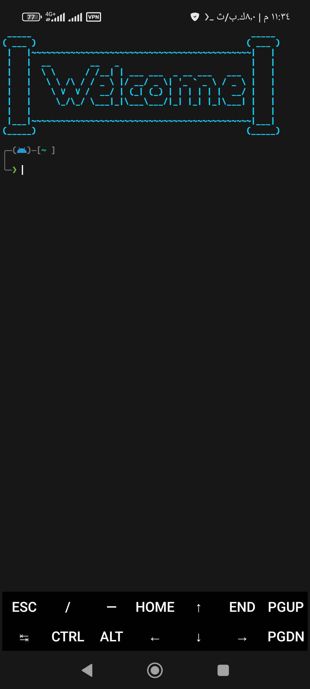
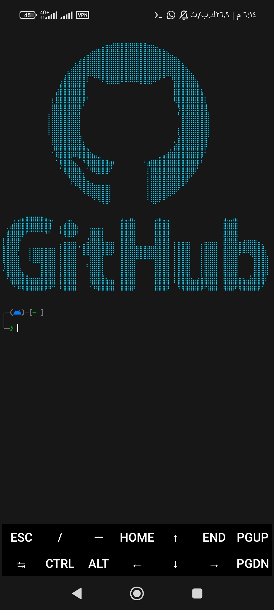

# My-Zsh

A minimal, fast, and fully self-installing Zsh configuration built for **Termux** (Android). One command clones it, one script sets it up — no manual dependency chasing.


--- 


## Features

- **Zero-friction install** — a single Python installer detects your environment, updates Termux, installs every missing dependency, and drops each config file exactly where it belongs.
- **Smart prompt** — powered by [Starship](https://starship.rs), showing OS, directory, git branch/status, command duration, and language versions (Node, Python, Rust, Go) only when relevant.
- **Modern CLI replacements** — `eza` instead of `ls`, `bat` for paging, `ripgrep` and `fd` for search, `zoxide` for smarter `cd`.
- **Fuzzy everything** — `fzf` wired into file search and history, with a live preview pane.
- **Vi-mode editing** — `zsh-vi-mode` with per-mode cursor shapes, plus autosuggestions, syntax highlighting, and substring history search.
- **Pinned plugin manager** — a lightweight custom loader that clones missing plugins on first run, pinned to fixed upstream tags so every install gets the same tested code; no external plugin framework required.
- **Safe by default** — the installer backs up your existing zsh config before touching anything, ships an uninstaller that restores it, and never aliases `rm` to something destructive.
- **Colorful, transparent installer output** — powered by [rich](https://github.com/Textualize/rich), with spinners for long-running steps and clear pass/fail messages for every stage.

## Requirements

- [Termux](https://termux.dev) (F-Droid build recommended)
- An internet connection (the installer updates packages and installs missing tools automatically)

You don't need to pre-install anything else — Python is the only manual step, and the installer script handles even that for you.

## Installation

```bash
pkg install git -y
git clone https://github.com/aelalmy45/My-Zsh.git
cd My-Zsh
bash install.sh
```

`install.sh` is a tiny bootstrap: it makes sure Python is available, then hands off to `install.py`, which does everything else.

**After the installer finishes, fully close and reopen Termux** (not just a new tab — the app itself). Some settings (like `$ZDOTDIR`) only load on a fresh login shell, so a full restart ensures everything activates correctly.

## What the Installer Does

`install.py` runs in four stages, each with clear colored feedback:

| Stage | What happens |
|---|---|
| 1. Rich setup | Installs the `rich` Python library used for the installer's own colored output |
| 2. System update | Runs `pkg update && pkg upgrade` to refresh Termux's package index |
| 3. Dependency check | Scans for required tools; anything missing is installed automatically |
| 4. Backup | Copies any existing `~/.zprofile`, `~/.zshenv`, and `~/.config/zsh` into a timestamped folder under `~/.local/share/my-zsh/backups/` |
| 5. File placement | Copies every config file to its correct destination |

If any stage fails (no internet, a broken package, etc.), the installer stops immediately with a clear red error message instead of continuing in a broken state.

## Uninstalling

Every install is reversible. Before the installer overwrites anything it saves your previous config, and the uninstaller puts it back:

```bash
bash uninstall.sh
```

This removes the My-Zsh files and restores the most recent backup. Useful flags:

- `--list` — show all saved backups
- `--backup <path>` — restore a specific backup instead of the latest one
- `--yes` — skip the confirmation prompt

The Termux font (`~/.termux/font.ttf`) is left in place, since it is harmless on its own.

## Tools Installed

| Command | Package | Purpose |
|---|---|---|
| `zsh` | `zsh` | The shell itself |
| `git` | `git` | Version control, plugin management |
| `eza` | `eza` | Modern `ls` replacement |
| `rg` | `ripgrep` | Fast text search |
| `fd` | `fd` | Fast file search |
| `bat` | `bat` | Syntax-highlighted file viewer / pager |
| `zoxide` | `zoxide` | Smarter directory jumping |
| `fzf` | `fzf` | Fuzzy finder |
| `lf` | `lf` | Terminal file manager |
| `nvim` | `neovim` | Default editor |
| `starship` | `starship` | Prompt engine |

## Project Structure

```
My-Zsh/
├── .zprofile          # Login-shell env vars (XDG dirs, ZDOTDIR, EDITOR, PATH)
├── .zshrc              # Main shell config — sources all modules below
├── aliases.zsh         # Command shortcuts and small helper functions
├── banner              # ASCII art data, printed by banner.zsh
├── banner.zsh           # Prints the banner on shell start
├── bindings.zsh         # Custom keybindings (vi-mode aware)
├── fzf.zsh              # fzf configuration and Ctrl+F picker
├── plugins.zsh          # Minimal git-based plugin manager
├── prompt.zsh           # Starship initialization
├── starship.toml        # Prompt theme configuration
├── install.py           # Main installer logic (backs up your old config first)
├── install.sh           # Bootstrap entry point
├── uninstall.py         # Removes the config and restores the latest backup
├── uninstall.sh         # Bootstrap entry point for the uninstaller
├── LICENSE               # MIT (with attribution to the upstream config)
└── images/               # README assets
```

## Where Files Get Installed

| File | Destination |
|---|---|
| `.zprofile` | `~/.zprofile` |
| Everything else (`.zshrc`, `aliases.zsh`, `banner`, `banner.zsh`, `bindings.zsh`, `fzf.zsh`, `plugins.zsh`, `prompt.zsh`, `starship.toml`) | `~/.config/zsh/` |

`README.md`, `install.py`, `install.sh`, `images/`, and `.gitignore` stay in the repo and are never copied — they're project files, not shell config.

## Key Aliases

| Alias | Does |
|---|---|
| `py` | `python` |
| `ls` / `ll` / `la` / `tree` | `eza` in various modes (icons, git status, detail) |
| `..` / `...` / `....` | Go up 1 / 2 / 3 directories |
| `-` | `cd -` (jump to previous directory) |
| `c` | `clear` |
| `pu` | `pkg update && pkg upgrade` |
| `gs` / `ga` / `gc` / `gp` / `gl` | `git status` / `add` / `commit` / `push` / `pull` |
| `glog` / `gadog` | Pretty, paged git log views |
| `vim` | `nvim` |

> ℹ️ Note: `rm` is a safety wrapper, not the raw command. With [trash-cli](https://github.com/andreafrancia/trash-cli) installed (`pip install trash-cli`) files go to the trash instead of being deleted; otherwise `rm` asks before removing anything. Use `command rm` when you deliberately want the real thing.

## Keybindings

| Keys | Action |
|---|---|
| `Ctrl` + `→` / `←` | Jump forward / backward one word |
| `Ctrl` + `F` | Open fzf file picker (hidden files excluded) |
| `Ctrl` + `\` | Toggle autosuggestions |
| `↑` / `↓` | History substring search |

## Plugins

Installed automatically on first shell launch — no manual setup needed:

- [zsh-autosuggestions](https://github.com/zsh-users/zsh-autosuggestions)
- [zsh-history-substring-search](https://github.com/zsh-users/zsh-history-substring-search)
- [zsh-vi-mode](https://github.com/jeffreytse/zsh-vi-mode)
- [fast-syntax-highlighting](https://github.com/zdharma-continuum/fast-syntax-highlighting)

Each plugin is pinned to a fixed tag in `plugins.zsh` (currently autosuggestions v0.7.1, history-substring-search v1.1.0, zsh-vi-mode v0.12.0, fast-syntax-highlighting v1.56), so a fresh install never breaks because an upstream default branch changed. `zplugin-update` re-clones the pinned versions; to upgrade a plugin, bump its tag in `plugins.zsh` first.

## Customizing

- Add your own shortcuts in `aliases.zsh`.
- Add or remove plugins by editing the `_zplugin_load` calls in `plugins.zsh`.
- Tweak prompt segments, colors, or icons in `starship.toml`.

Since the installer copies these files fresh from the repo, keep your personal tweaks committed to your own fork if you plan to reinstall on another device.

## Troubleshooting

**Banner/prompt/aliases don't load after installing.**
Make sure you fully closed and reopened the Termux app (not just `exec zsh`). `.zprofile` only runs on a genuine login shell.

**`pkg install` fails during setup.**
Usually a connectivity issue. Re-run `bash install.sh` once you have a stable connection — the installer safely skips anything already installed.

## Credits

This configuration builds on the excellent [zsh setup by Radley Sidwell-Lewis](https://github.com/radleylewis/zsh), adapted and extended for a fully automated Termux install.

## License

[MIT](LICENSE). The upstream [zsh setup by Radley Sidwell-Lewis](https://github.com/radleylewis/zsh) is MIT licensed too; its copyright notice is preserved in the LICENSE file.
